# Milestones

Each milestone gets before/after screenshots taken the same way, so they compare
cleanly. `tools/sbs.swift` composes each pair side by side.

## How the shots are taken

- Light color scheme, so the scene is in daytime.
- The app pane at its normal width (800 px).
- **overview**: the full pane after the page loads, with Esc pressed to stop the
  startup tour. It includes the side panel, so UI and text changes show.
- **closeup**: the map region (800 × 545) after 16 scroll steps in at the same
  point on the map.
- **roles closeup**: as closeup, but in the 人力 view with people on.
- **hover**: as closeup, with the pointer held on one landmark (the 衛福 minibus,
  at 215, 300 in the pane).

"Before" is the commit just before the milestone and "after" is the milestone
itself. Earlier milestones were captured afterwards, by serving each old commit
from its own git worktree on its own port so browser caches couldn't mix
versions. People, boats and clouds move, so they differ between shots.

To compose a pair:

```bash
swiftc -O tools/sbs.swift -o /tmp/sbs && /tmp/sbs before.png after.png pair.png "Title"
```

## Gallery

### 1 · Flat prototype (`2643cfa`)

A flat SVG hex map with a SimCity-style resource selector. This is the starting
point, so there is no before.

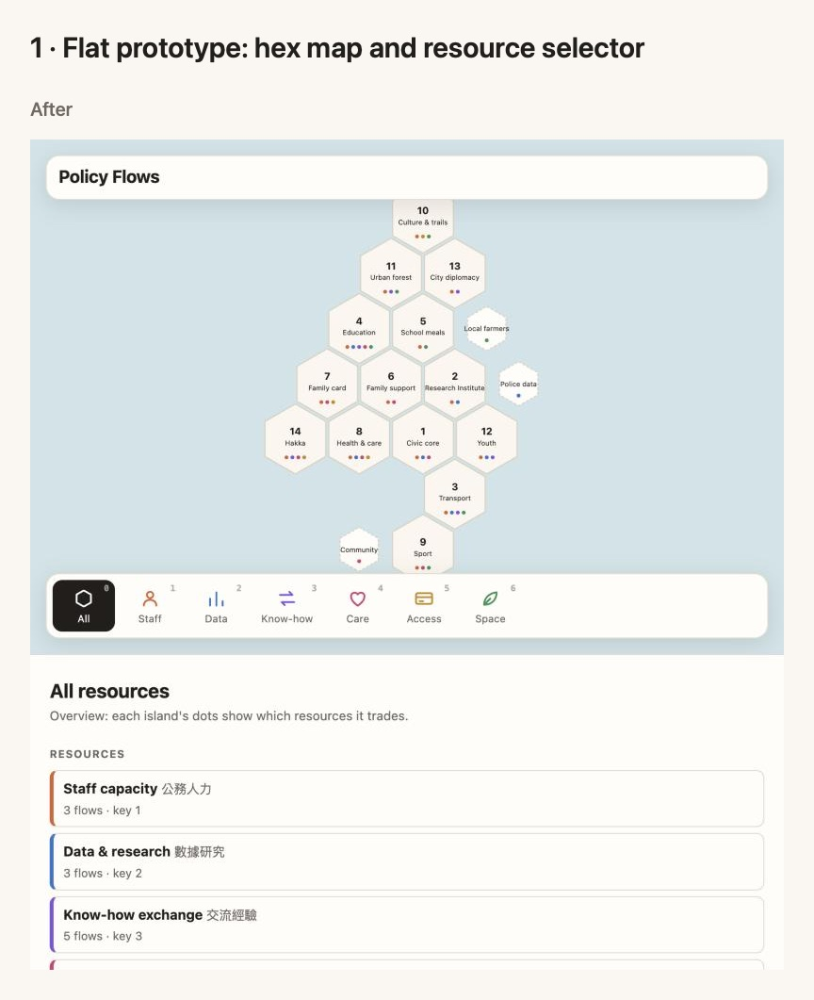

### 2 · 3D diorama (`2643cfa` → `d50736f`)

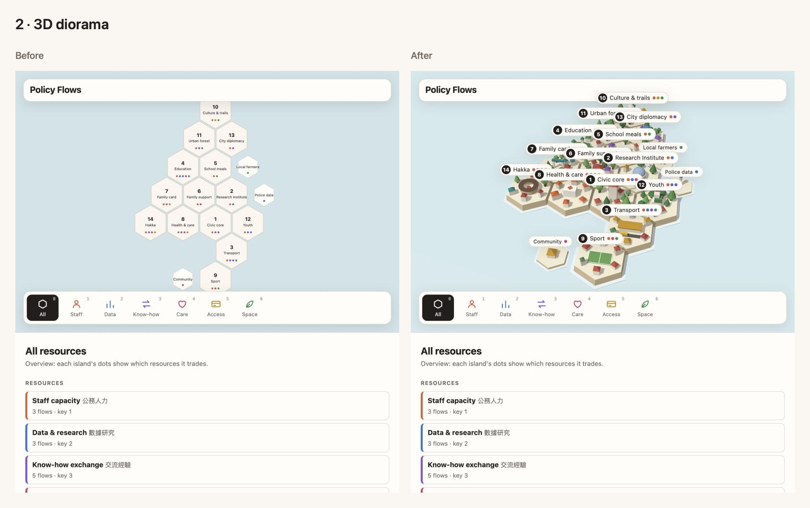

### 3 · Traditional Chinese text (`d50736f` → `3f6cd11`)

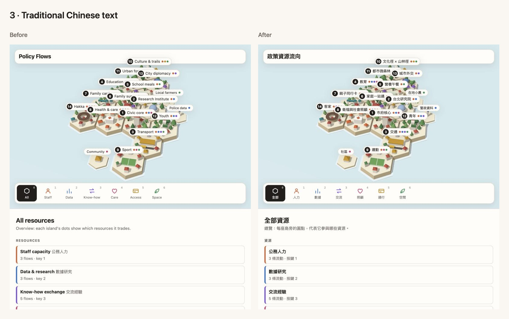

### 4 · People walk the lanes over roads and bridges (`0c320c4` → `00dacd6`)

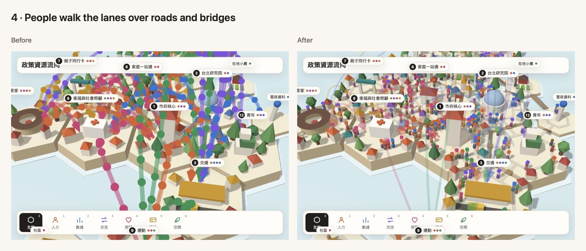

### 5 · Public demo: empty default, toggles, disclaimer (`00dacd6` → `ae0f46b`)

Covers everything up to the first public deploy: the empty default view, the
人物 and 箭頭 toggles, the startup tour, hover highlights and the 非官方
prototype badge.

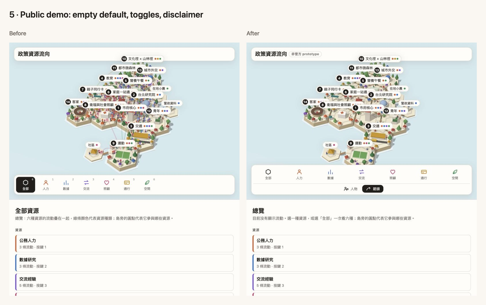

### 6 · Visual pass: lit basin, cozy models, day and night (`ae0f46b` → `919636d`)

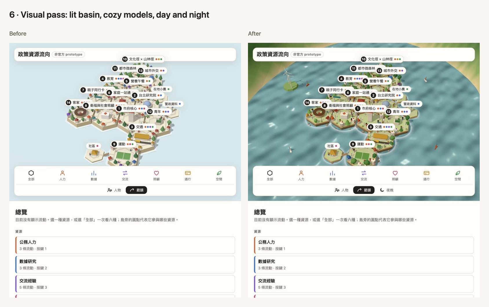
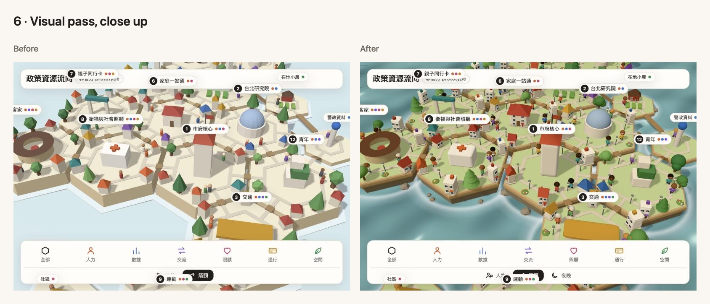

### 7 · People dress for their flow (`919636d` → `e8540b8`)

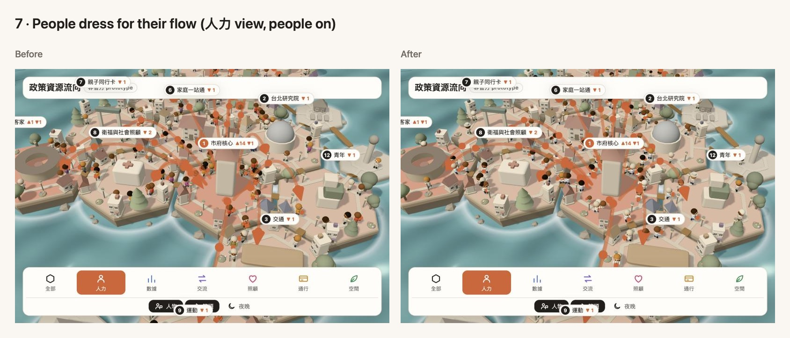

### 8 · Policy landmarks (`e8540b8` → `5887719`)

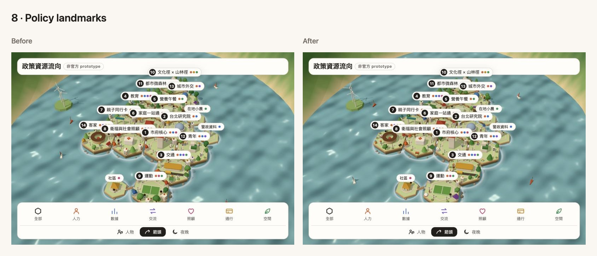
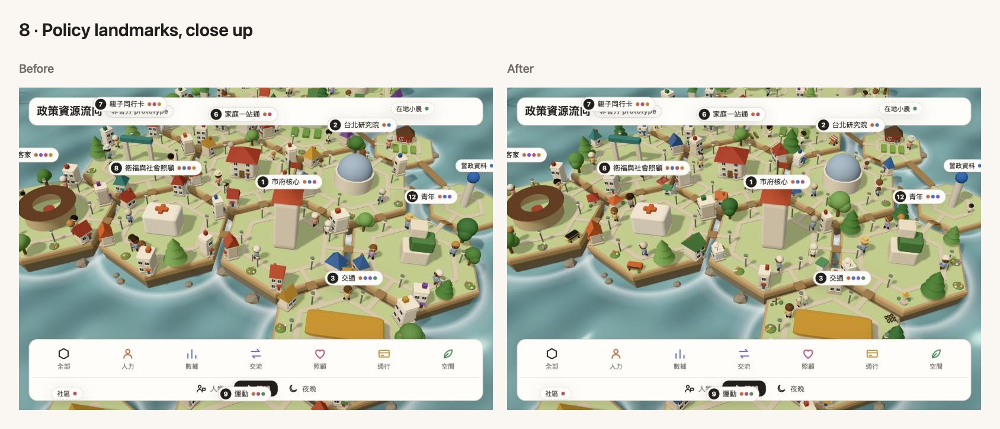

### 9 · Hover labels for policy landmarks

Close-up with the pointer on the 衛福 minibus. Before, the tip summarized the
island. After, it names the policy item the model stands for (在宅醫療).

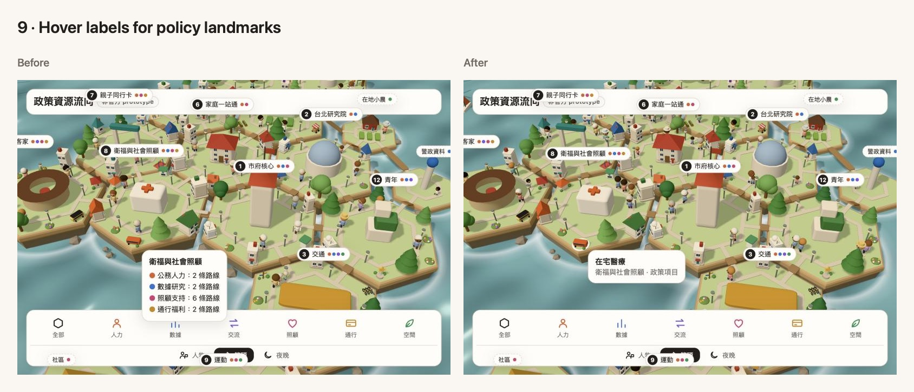
### 10 · Water and night

Day overview, night overview (夜晚 on) and night close-up.

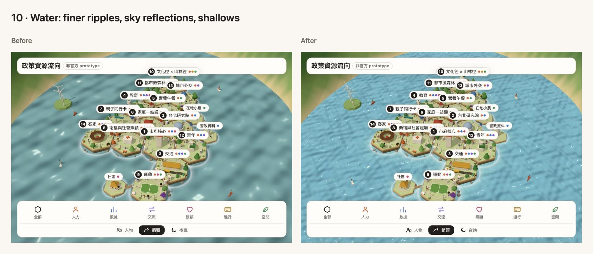
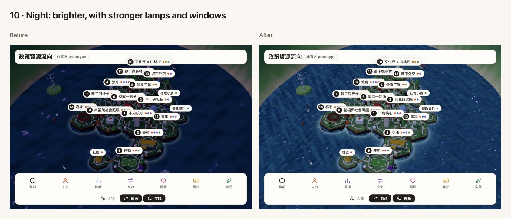
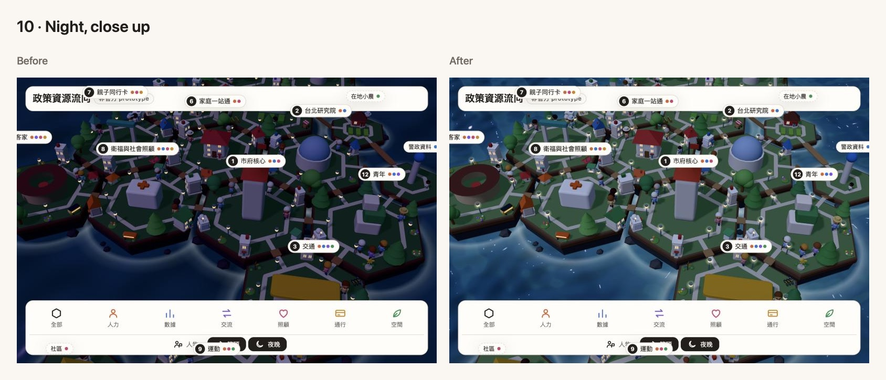

### 11 · Shader water

Taken in a wider pane (map 684 px beside the panel, 535 × 545 crop), so it isn't
framed like the earlier pairs, but before and after match each other.

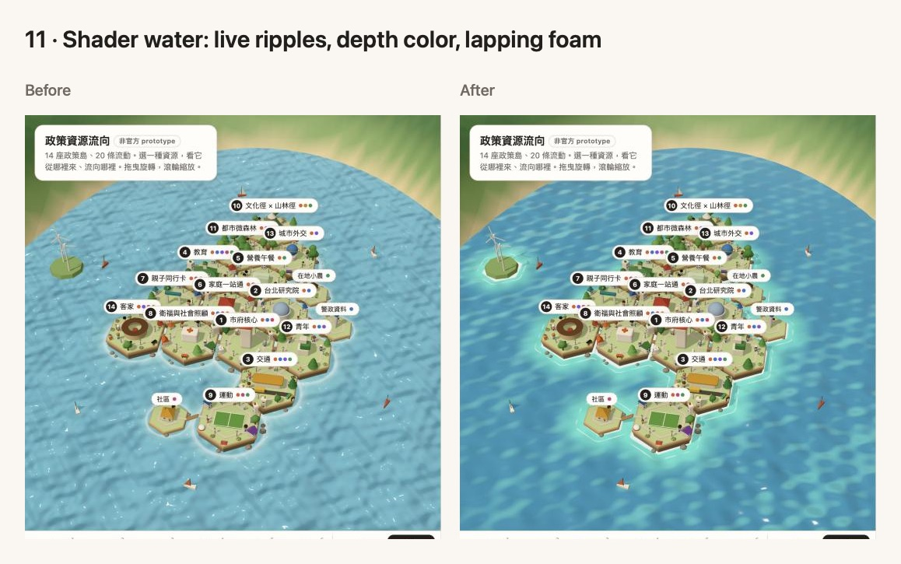
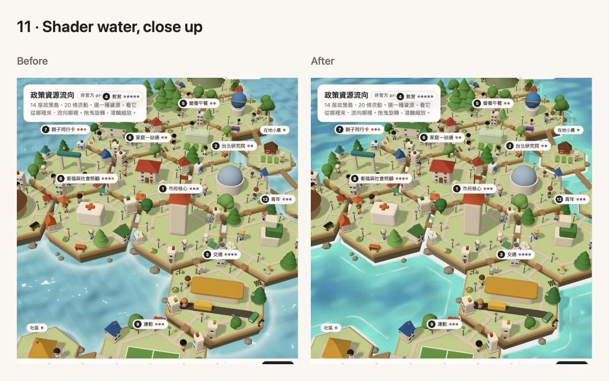
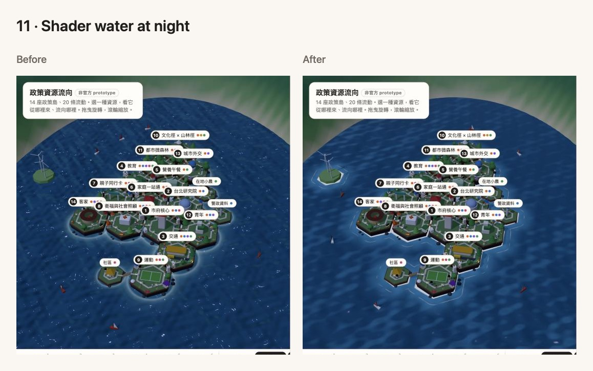
